# koppter


A [todo.txt](https://github.com/todotxt/todo.txt) application for Android and for Windows and Linux desktops.

Status: early development on the `experimental` branch.
The Android application is built but has not been run on a device yet.

## Screenshots

The tasks in the screenshots are invented.

The task list with the filter panel.
Projects, contexts, tags and the priority are labels at the top right of each task.

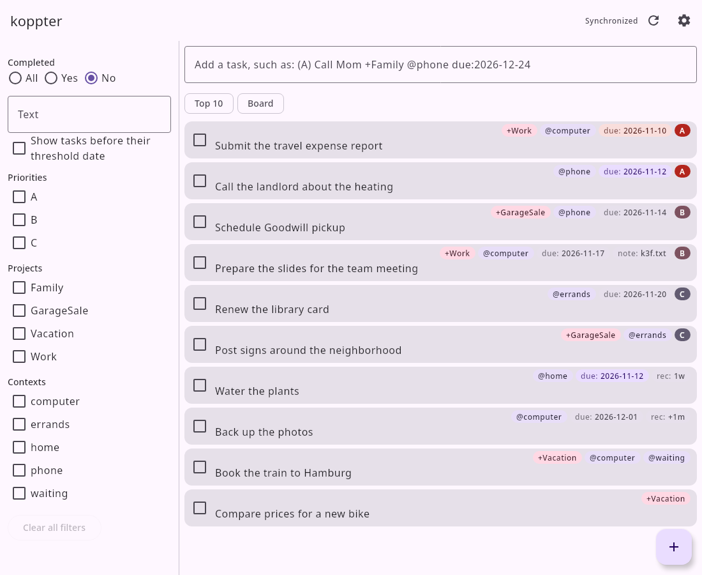

The filter panel offers priorities, projects, contexts and hashtags as the labels that the tasks carry.
A click moves a label to the selected ones beside the title; here, the list shows the tasks of the projects *GarageSale* or *Work* that have the context *phone*.

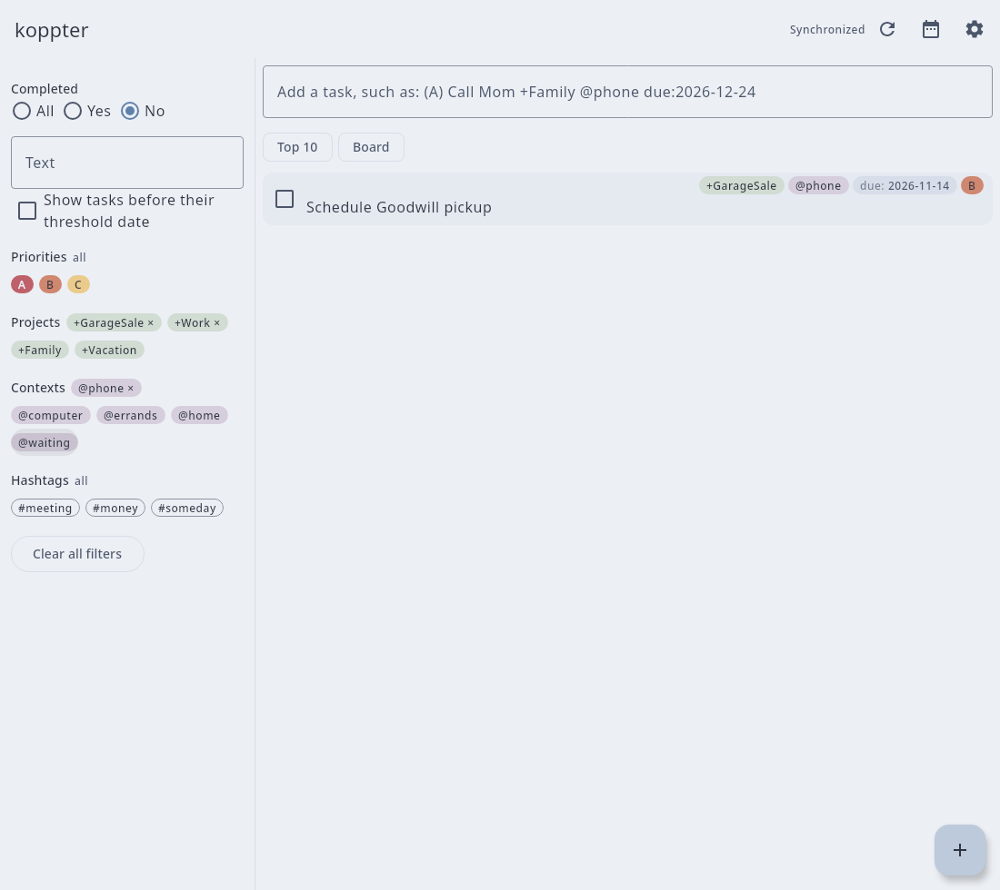

The board with one column per priority, while a task is dragged from column B to column A.

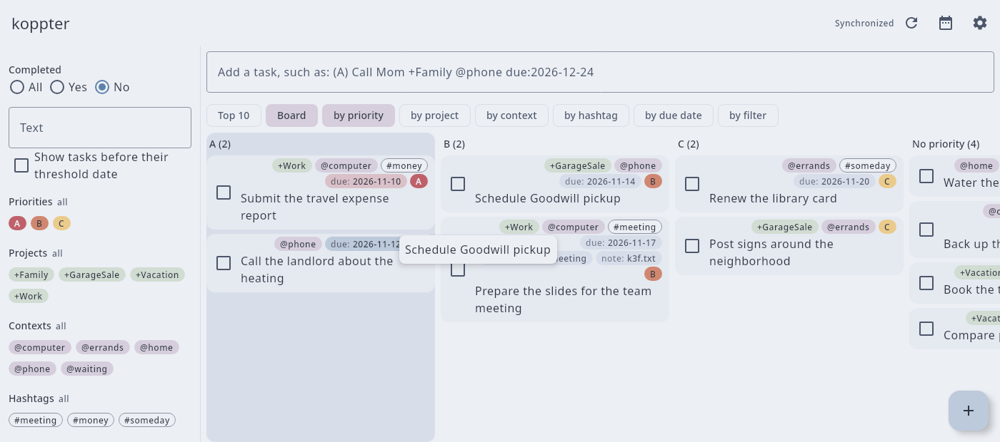

The board with one column per project.

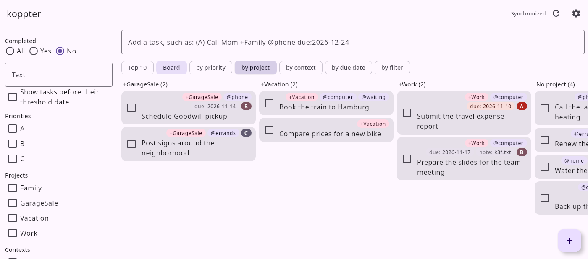

The board with [columns defined by filters](#board): *Now* is `due:<=today -@waiting`, *Waiting* is `@waiting`, *This week* is `due:<1w`, *Important* is `(>C)`.

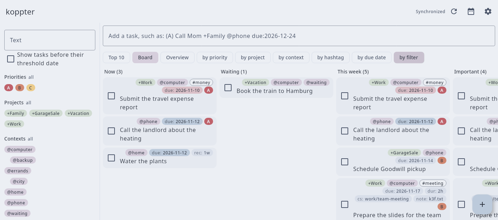

The overview tells how each context is doing: red if a task is overdue, yellow if one is due today.

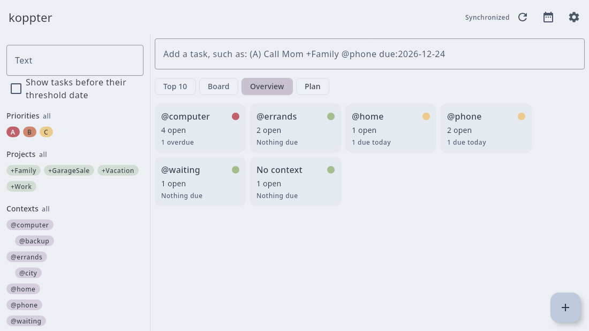

A click on a context shows its tasks, the most urgent first; the bar of a task fills from its start to its due date.

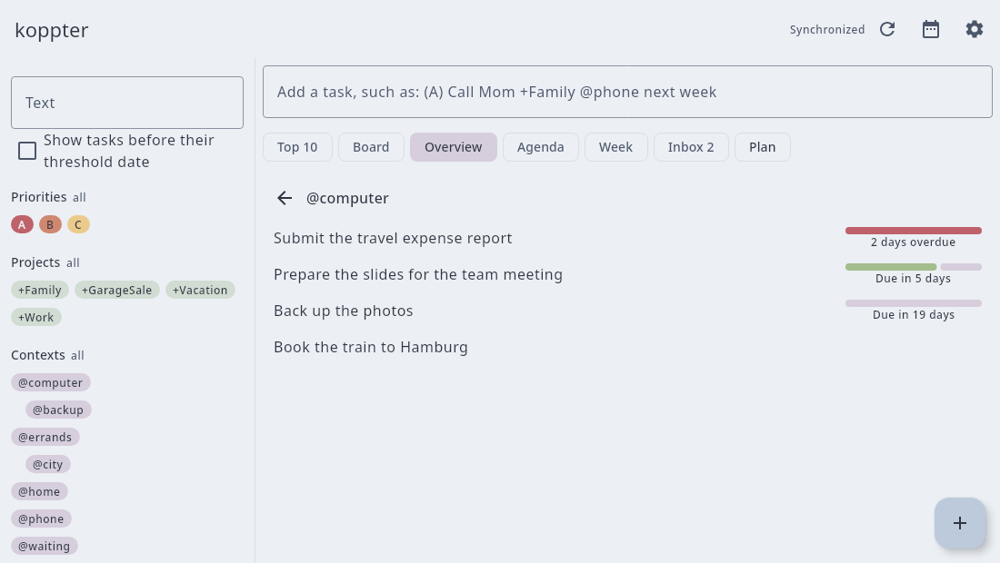

*Plan* with the time maps, the time maps of contexts and the barriers; the calendar icons of the tasks tell the state of their plan.

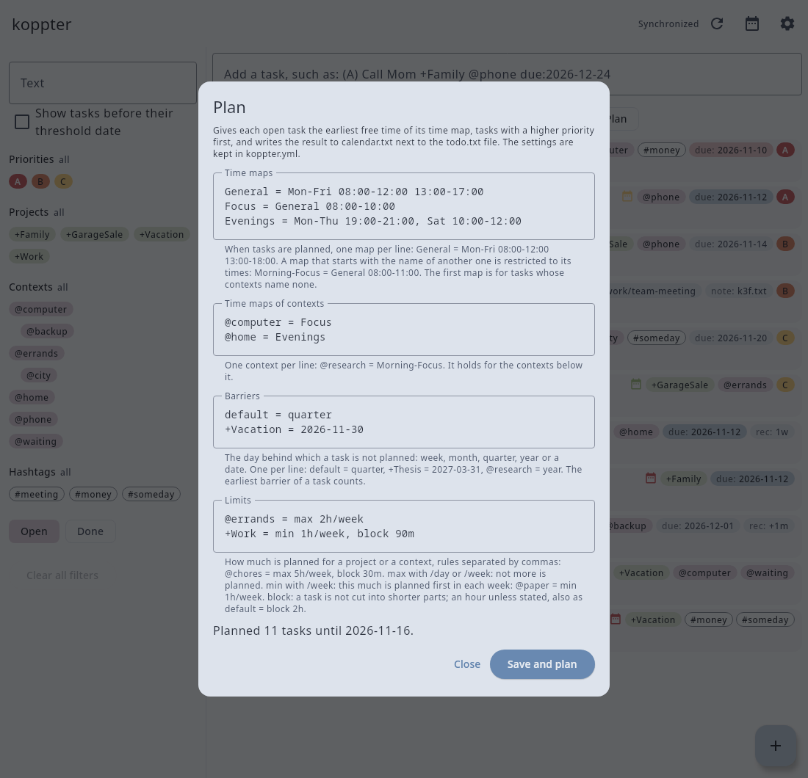

The edit dialog: the description without metadata at the top, the metadata below, then the note, the resulting line of the todo.txt file, and the date the task was added according to the git history.

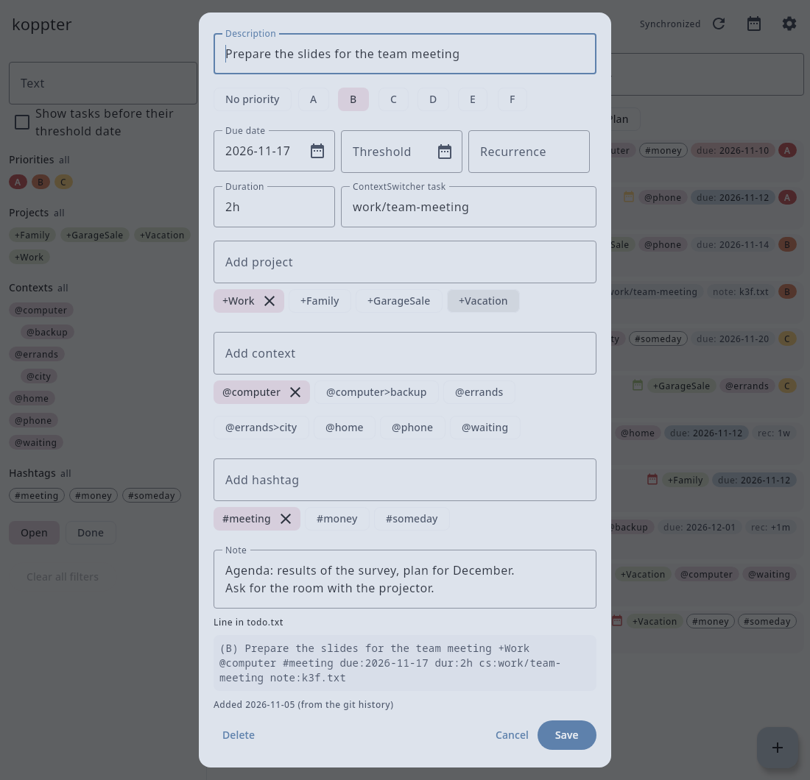

The settings, with the board columns by filter and the public SSH key for the git repository.

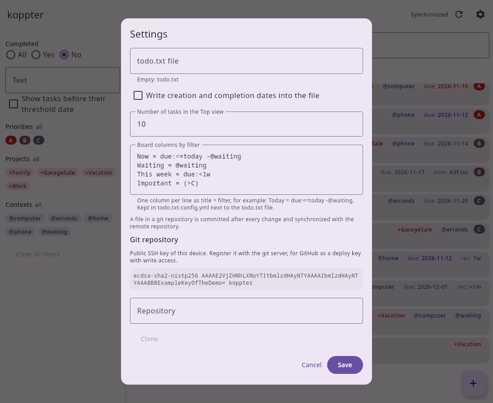

The editor of the scheduled tasks tells for each entry on which day it adds its task next.

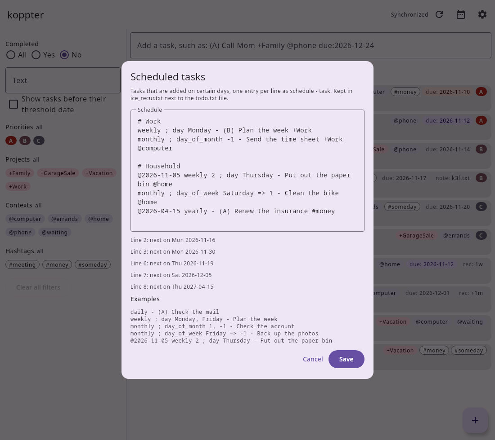

In a narrow window, as on a phone, the filter panel is a drawer.

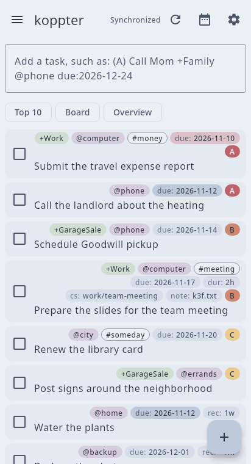

The colors are those of the palette [Nord](https://www.nordtheme.com/) or [Everforest](https://github.com/sainnhe/everforest), light or dark; the settings choose, and by default the application follows the system ([decision 0015](docs/decisions/0015-colors-from-published-palettes.md)).
The screenshots above show Nord in its light variant.

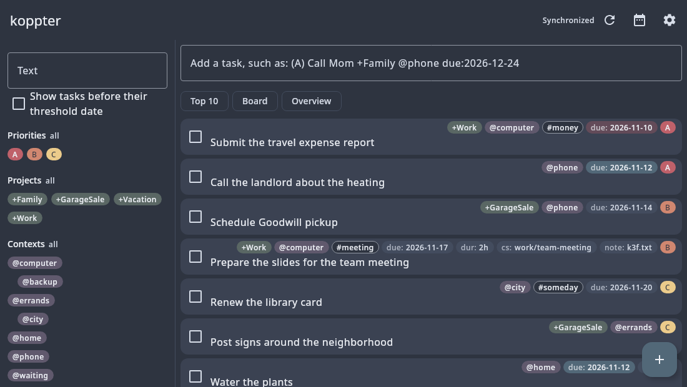

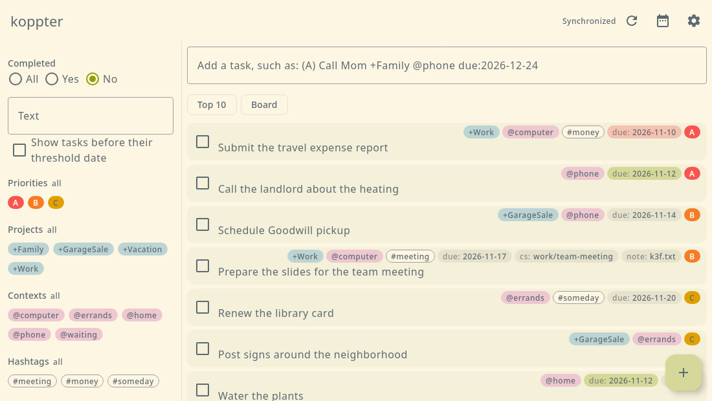

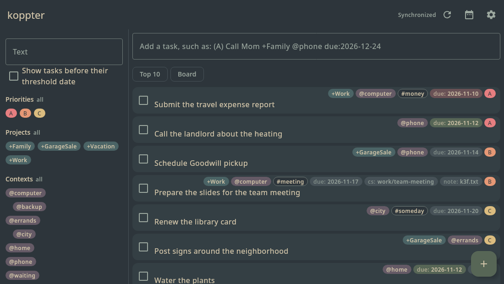

## Goals

* The todo.txt file is the only data store, and it stays a file that other todo.txt tools can read and write.
* One code base for phone and desktop: Kotlin Multiplatform with Compose Multiplatform ([decision 0001](docs/decisions/0001-kotlin-multiplatform-with-compose-multiplatform.md)).
* Synchronization through git, with one commit per added and per completed task.
  The dates a task was added and completed are then read from the history instead of being written into the file.
* Synchronization through a local folder and through OneDrive.
* A task list that shows projects, contexts, hashtags, due date and priority as labels at the top right of each task.
* An edit dialog that separates the description from the metadata and shows the resulting todo.txt line.
* A filter panel for completion state, text, priorities, projects, contexts and hashtags.
* A Kanban board.
* Support for the [extensions](#extensions-of-the-todotxt-format) `note`, `top` and `ice_recur`, for the `rec:` and `t:` tags, and for hashtags.

The planned scope is tracked as requirements in [docs/requirements](docs/requirements/README.md).

## Files

| File | Content |
| --- | --- |
| `todo.txt` | The tasks |
| `notes/<name>.txt` | The note of the task with the tag `note:<name>.txt` |
| `koppter.yml` | Configuration of this application that belongs to the todo.txt file: the [board columns defined by filters](#board), the [share actions](#sharing-to-koppter-on-android), and the time maps and barriers for [planning](#planning) |
| `ice_recur.txt` | Schedules of [recurring tasks](#recurring-tasks) in the format of the ice_recur add-on, such as `weekly ; day Monday - (B) Plan the week` |
| `calendar.txt` | The [plan](#planning): when the open tasks are worked on, one line per day |
| `calendar.ics` | The plan as tentative events, for import into a calendar program |

If these files lie in a git repository, the application commits every change and synchronizes with the remote repository.

A file in OneDrive, or in another storage service, is used through the platform ([decision 0011](docs/decisions/0011-onedrive-through-the-platform.md)): on Android, choose it with *Choose file* in the settings; on the desktop, choose it in the synchronized folder.

## Extensions of the todo.txt format

The [todo.txt format](https://github.com/todotxt/todo.txt) defines the completion mark `x`, the priority `(A)`, dates, `+project`, `@context` and tags of the form `key:value`.
The application understands the following extensions, which other todo.txt tools use as well.

| Notation | Meaning | How to use it |
| --- | --- | --- |
| `due:2026-12-24` | Due date | *Due date* in the edit dialog. The label is highlighted on the day and marked when the date has passed; the list orders tasks of equal priority by due date. |
| `t:2026-12-01` | Threshold date: the task is not relevant before that day | *Threshold* in the edit dialog. The task is hidden until that day; *Show tasks before their threshold date* in the filter panel shows it. |
| `rec:1w` | Recurrence: completing the task adds its next occurrence | See [recurring tasks](#recurring-tasks). |
| `ice_recur.txt` | Schedules that add tasks on certain days | See [recurring tasks](#recurring-tasks). |
| `note:k3f.txt` | A note for the task, kept in the file `notes/k3f.txt` | *Note* in the edit dialog; the application names the file. As in the [note add-on](https://github.com/mgarrido/todo.txt-cli/tree/note/todo.actions.d). |
| `#urgent` | Hashtag: a third kind of label next to `+project` and `@context`, without a fixed meaning | *Add hashtag* in the edit dialog, or typed into the task. A hashtag starts with a letter: `#123` and `C#` stay words of the description ([decision 0014](docs/decisions/0014-hashtags-as-a-third-kind-of-label.md)). |
| `@research>reading` | A context below another context, over any number of levels | Typed as the context. The label shows `@reading`, and the path when the pointer rests on it; a click on it shows the tasks of the context. A filter for `@research` includes the contexts below it, and the filter panel shows the contexts as a tree ([decision 0017](docs/decisions/0017-levels-of-a-context-separated-by-a-greater-than-sign.md)). |
| `dur:1h30m` | The time the task is expected to take, in hours and minutes | Field *Duration* in the edit dialog, or typed into the task. Nothing is computed from it yet ([decision 0018](docs/decisions/0018-tag-for-the-duration-of-a-task.md)). |
| `cs:jabref/fix-npe` | The task of [ContextSwitcher](https://github.com/contextswitcher/contextswitcher) that holds the working context | Entered in the field *ContextSwitcher task* of the edit dialog or typed into the task, as the id or as the link that *Copy link* of ContextSwitcher gives, which becomes the tag. A click on the label switches to the task in ContextSwitcher, on a computer where it has registered its links ([decision 0016](docs/decisions/0016-tag-for-the-task-of-contextswitcher.md)). |
| `pri:A` | The priority a completed task had | Written when a task with a priority is completed, as the format has no priority for completed tasks; reopening the task restores the priority. |

The *Top* switch above the list restricts it to the first tasks, whose number is a setting.
There is no notation for a most important task: priority `(A)` together with a due date serves that purpose ([decision 0009](docs/decisions/0009-no-notation-for-most-important-tasks.md)).

Notes, `ice_recur.txt` and the board columns by filter need a todo.txt file in a folder or a git repository.
They are not available for a file chosen through the document picker of Android, as the application then has access to that one file only.

### Recurring tasks

There are two ways to make a task recur.
They differ in what triggers the next task: completing the previous one, or the calendar.

#### After completion: the tag `rec:`

Use it for a task whose next occurrence only makes sense once the current one is done, such as watering the plants.
There is one open task at a time.

1. Add the task with a due date and a recurrence, in the edit dialog or as a line: `Water the plants due:2026-11-12 rec:1w`.
2. Complete the task when it is done.
3. The application marks it as completed and adds the same task with the next due date.

The recurrence is an amount and a unit; without an amount it is one unit.

| Unit | Meaning | Example |
| --- | --- | --- |
| `d` | days | `rec:3d` |
| `b` | business days, Monday to Friday | `rec:b` |
| `w` | weeks | `rec:2w` |
| `m` | months | `rec:m` |
| `y` | years | `rec:1y` |

The next due date counts from the day of completion.
With a `+` in front of the interval, it counts from the previous due date, however late the task was completed:

| Task | Completed on | Next task |
| --- | --- | --- |
| `Water the plants due:2026-11-12 rec:1w` | 2026-11-14 | `Water the plants due:2026-11-21 rec:1w` |
| `Pay the rent due:2026-11-01 rec:+1m` | 2026-11-03 | `Pay the rent due:2026-12-01 rec:+1m` |

A threshold date moves along with the due date and keeps its distance to it.
A task with a threshold date only gets the next threshold date, and a task with neither date gets a due date.
The next task keeps the priority.

#### By the calendar: the file `ice_recur.txt`

Use it for a task that has to appear on certain days whether or not the previous one is done: every Monday, on the first of the month, on the last Friday of the month.
The format is that of the [ice_recur](https://github.com/rlpowell/todo-text-stuff/blob/master/ice_recur) add-on.

1. Open the editor with the calendar button in the top bar.
   It edits the file `ice_recur.txt` next to the todo.txt file, which any text editor can edit as well; the file name is fixed, as in the add-on.
2. Write one entry per line: `[@start] [@@end] timing - task`.
   The part after ` - ` is the task as it is added to the todo.txt file.
3. The application adds the tasks of the day when it is open, once per day.
   The days since it was last open are caught up.
   A task of an entry that is added or changed in the editor and occurs today is added at once.
4. Below the text, the editor tells for each entry the next day on which it adds its task, and which lines it does not understand.

| Entry | Adds the task |
| --- | --- |
| `daily - (A) Check the mail` | every day |
| `weekly ; day Monday - (B) Plan the week` | every Monday |
| `weekly ; day Friday, Sunday - Empty the bins` | every Friday and Sunday |
| `@2026-11-02 weekly 2 ; day Thursday - Put out the paper bin` | every second Thursday, counted from the week of 2026-11-02 |
| `monthly ; day_of_month 1, 15 - Check the account` | on the 1st and the 15th of every month |
| `monthly ; day_of_month -1 - Send the time sheet` | on the last day of every month |
| `monthly ; day_of_week Friday => -1 - Back up the photos` | on the last Friday of every month |
| `monthly ; day_of_week Tuesday => 1, 3 - Team meeting` | on the first and the third Tuesday of every month |
| `@2026-03-01 monthly 3 - Read the meters` | every three months on the day of the start date: 1 March, 1 June, … |
| `@2026-01-04 yearly - Renew the membership` | every year on 4 January |
| `yearly ; month_of_year March, September - Change the tires` | on the 1st of March and of September |
| `@2026-06-01 @@2026-08-31 daily - Water the garden` | every day from 1 June to 31 August 2026 |

* The timing starts with `daily`, `weekly`, `monthly` or `yearly`, optionally followed by an interval: `weekly 2` is every second week.
* Further restrictions follow, each separated by ` ; ` with a blank on both sides: `day`, `day_of_month`, `day_of_week`, `day_of_year`, `month_of_year`.
* Days and months are written as English names or as numbers; for days of the week, 0 is Sunday.
  A negative number counts from the end: `day_of_month -1` is the last day of the month.
* Without a start date, intervals count from 2018-01-01, a Monday, as in the add-on.
  An entry with an interval greater than one should therefore have a start date.
* A line that starts with `#` is a comment.

A task is not added while an open task with the same text exists, so tasks that are not completed do not pile up.
Two tasks have the same text if they differ at most in priority, dates and the tags `t:`, `due:` and `note:`.

The application differs from the add-on in these points:

* The add-on is started once a day by a scheduler; the application runs the schedules itself, and only while it is open.
* The add-on always writes the creation date; the application writes it only if writing dates is switched on in the settings.
* The add-on stops at a line it does not understand; the application skips the line and marks it in its editor.
* The options of the add-on to ignore projects and contexts when comparing tasks do not exist.
* Each device remembers on its own when it last ran the schedules.
  In a git repository, a task that any device added since then counts as existing, also when it is completed already.
  Without git, a second device may add a task again that was added and completed on the first.

## Overview

The switch *Overview* above the tasks shows one tile per context of the outermost level instead of the tasks.
A tile counts the open tasks of the context and of the contexts below it, and its dot tells the state of the most urgent one: overdue, due today, or neither.
The tasks without context have a tile of their own.
The filter panel applies to the overview as it does to the list.

A click on a tile lists the tasks of the context, the most urgent first and those without due date last.
The bar of a task shows how much of its time has passed: from its threshold date (`t:`) to its due date, else from its creation date, else over the two weeks before the due date.

## Inbox

*Inbox* above the tasks lists the open tasks without context, and the switch tells how many there are.
Each task shows the contexts of the file; a click on one gives it to the task, which then leaves the inbox.

With the keyboard, one task is marked.
Typing narrows the contexts of the marked task, and Enter gives it the first one shown: `rea` and Enter for `@research>reading`.
If no context contains the typed text, Enter gives the text as a new context.
The arrow keys up and down mark another task, to leave one where it is.

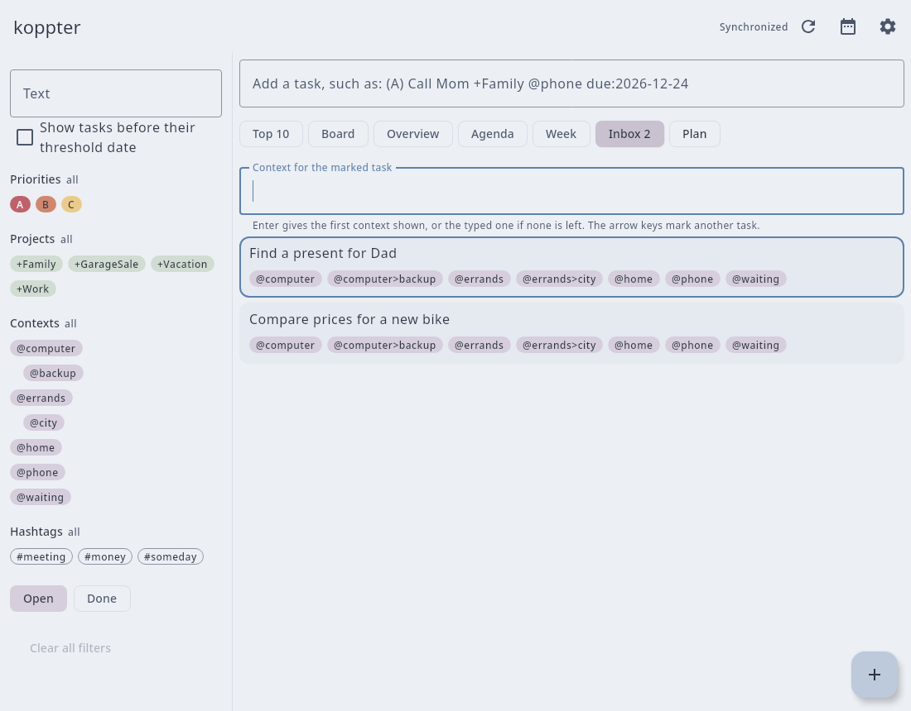

## Planning

*Plan* above the tasks gives each open task times in which it is to be worked on and writes them to `calendar.txt` next to the todo.txt file.
The todo.txt file leads: the plan is computed from it, and planning does not change it.

* A task with a higher priority is planned first, and every task gets the earliest free times, so that tasks without dates are planned soon as well.
* A task takes its duration (`dur:`), half an hour without one, and is not planned before its threshold date (`t:`).
  A free time that is too short takes a part of the task.
* A **time map** names times of the week: `General = Mon-Fri 08:00-12:00 13:00-18:00`.
  A map that starts with the name of another one is restricted to its times: `Morning-Focus = General 08:00-11:00`.
  The first map is for tasks whose contexts name none.
* A context gets a time map: `@research = Morning-Focus`.
  It holds for the contexts below it, such as `@research>reading`, unless they name their own.
* A **barrier** is the day behind which a task is not planned: `week`, `month`, `quarter` (the default), `year` or a date.
  It is set in general (`default = year`), for a project (`+Thesis = 2027-03-31`) or for a context (`@research = year`); the earliest barrier of a task counts.
  A task that does not fit before its barrier is listed after planning instead of being planned later.

After the first plan, each open task carries a calendar icon: green if its plan ends before its due date or it has none, yellow if it ends on the due date, red if it ends later or the task is not planned.
The pointer on the icon shows the start of the plan.

`calendar.txt` has the [format of calendar.txt](https://terokarvinen.com/2021/calendar-txt/), one line per day:

```text
2026-11-16 w47 Mon  08:00-09:00 Read the survey @research>reading. 09:00-09:30 Call the landlord @phone
```

The lines of past days stay; the lines from today on are written anew by every plan, so what is written there by hand is lost.
In a git repository, each plan is one commit ([decision 0019](docs/decisions/0019-the-plan-is-derived-and-kept-in-calendar-txt.md)).
The plan is also written to `calendar.ics`, with tentative events, for import into a calendar program.

### Agenda and week

*Agenda* above the tasks shows the blocks of today and of the six days after it, each with its task, which is completed and opened there as in the list.
Below the blocks of today are the tasks that are due today or overdue and have no block today.

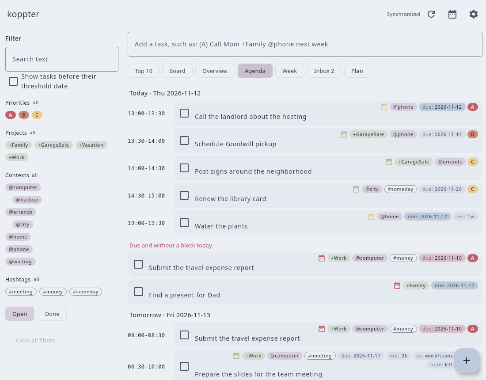

*Week* shows the blocks of a week as a calendar; a click on a block opens its task.

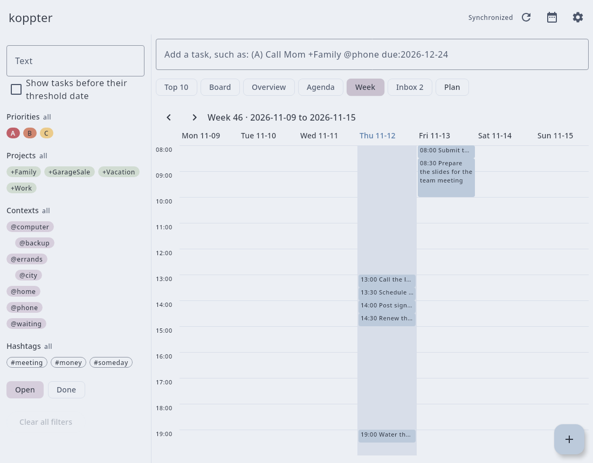

Both show what `calendar.txt` says: after tasks changed, *Plan* brings it up to date.
A block whose task was completed, deleted or edited since shows the text it was planned with.

### Calendars

*Calendars with busy times* in the plan dialog takes the addresses at which calendar services publish a calendar as an iCalendar file, one per line.
Nothing is planned into the times of their events; events of whole days, cancelled events and events marked as free do not count.

* Outlook on the web: *Settings → Calendar → Shared calendars → Publish a calendar*, then the ICS link.
* Google Calendar: *Settings → the calendar → Integrate calendar → Secret address in iCal format*.

Such an address lets everyone who has it read the calendar.
It is therefore kept in the settings of the device and not in `koppter.yml`; each device needs it entered once.
The application only reads the calendars and writes nothing to them.

### Limits of planning

* In the last days of a quarter, little fits before the default barrier, and most tasks count as not planned.
  `default = year` or a date moves the barrier.
* A block refers to its task by the text of the task.
  After the text, a project or a context of a task is edited, the task counts as not planned until the next plan.
* A time zone that the platform does not know by its name, as Outlook writes them (`W. Europe Standard Time`), counts as the time zone of the device.
  Events of a calendar that is kept in another time zone than that of the device are then read at the wrong time.
* An occurrence of a repeating event that was moved counts as busy at its old and at its new time.
* Whether a calendar program replaces the events of an earlier import of `calendar.ics` or adds them again has not been tried.
  The events carry the same id in every export, and the application leaves its own events out when it reads a calendar they were imported into.
* The events of the calendars are not shown in the agenda and the week: only their times are read, when planning.
  A task is not coupled to an event either.
* Reading calendars and the import of `calendar.ics` have been tried with files written for the tests, not with the calendars of Outlook or Google.

## Keyboard

| Keys | Effect |
| --- | --- |
| Ctrl+N | New task in the edit dialog |
| Ctrl+Enter | In the edit dialog: save |
| Esc | In the edit dialog: close without saving |
| Ctrl+Shift+A | Go to the line that adds a task |
| Ctrl+Shift+F | Go to the text of the filter |
| Ctrl+1 to Ctrl+6 | List, board, overview, agenda, week, inbox |
| Ctrl+Shift+O, Ctrl+Shift+Y, Ctrl+Shift+C | List, agenda, week, as in SkedPal outline, today list and calendar |
| Ctrl+Shift+L | Plan dialog |

On macOS, the command key takes the place of Ctrl.
There is no key yet that acts on a task of the list, such as completing or deleting it: the list has no marked task.

## Sharing to koppter on Android

A text that another application shares to koppter, such as the link of an article, becomes a task at once; no screen opens.
*Share actions* in the settings state what the task gets besides the shared text, one action per line as `name = task`:

```text
reading = {} @research>reading due:2w dur:1h
inbox = @inbox
```

* `{}` stands for the shared text; without it, the shared text stands in front.
* `due:` and `t:` may be relative to the day of sharing: `2w`, `3d`, `tomorrow`.
* From Android 10 on, each action is a target of its own in the share sheet, named as the action; the entry *koppter* applies the first action.
* The actions are kept in `koppter.yml` next to the todo.txt file, so that they can be edited on the desktop.
  They need a todo.txt file in the storage of the application or in a git repository, not one of a document provider.
* Words of the shared text that start with `+`, `@` or `#` become projects, contexts and hashtags of the task.

## Board

The board shows one column per priority, project, context, hashtag or due date range.
Dragging a task to another column changes that attribute of the task.

Columns can also be defined by filters, one per line as `title = filter`.
They are entered in the settings and kept in `koppter.yml` next to the todo.txt file, so that they are synchronized with the tasks ([decision 0012](docs/decisions/0012-board-columns-by-filter-in-a-file.md)):

```text
Now = due:<=today -@waiting
Waiting = @waiting
This week = due:<1w
Important = (>C)
```

| Term | Matches a task |
| --- | --- |
| `+project`, `@context`, `#hashtag` | with this project, context or hashtag |
| `(A)`, `(>B)`, `(<=C)` | with this priority, a higher one, this or a lower one |
| `due:today`, `due:<1w`, `t:>=2026-12-01`, `status:doing` | whose tag has this value or compares so to it; dates are ISO dates, `today`, `tomorrow`, `yesterday` or an interval from today |
| `-term` | that does not match the term |
| any other word | whose line contains it |

Dragging a task to such a column changes the task as little as possible so that it matches the filter ([decision 0013](docs/decisions/0013-smallest-change-on-drop-on-a-filter-column.md)): projects, contexts and tags are added or, for negated terms, removed, and a priority or date is set to the nearest value that matches.
Nothing else is removed, so the task stays in its former column as well unless the filter of the new column excludes that.
A column whose filter contains a word or a negated comparison does not take tasks.

In `koppter.yml`, a filter that contains a hashtag has to be quoted (`Doing: "#doing"`), as YAML reads an unquoted `#` as the start of a comment.
The application writes all filters quoted.

## Installing

The [latest release](https://github.com/koppor/koppter/releases/latest) carries the Android application as the file `koppter-<date>.apk`.
There is one release per day on which something changed, named after that day.
The desktop application is not packaged yet; it is started from the sources, see [running](#running).

## Building

Requirements: a JDK that starts Gradle (17 or newer) and the Android SDK (`ANDROID_HOME`, or `sdk.dir` in `local.properties`).
The build itself runs on JDK 25 and compiles for it.
The Gradle wrapper downloads everything else, including that JDK and the Android platform the build needs.

```shell
./gradlew build traceRequirements
```

`build` compiles and runs the unit tests and the user interface tests.
`traceRequirements` checks that every requirement and decision is covered ([OpenFastTrace](https://github.com/itsallcode/openfasttrace)); the report is written to `build/reports/tracing.txt`.

## Running

```shell
./gradlew :app:run
```

starts the desktop application.
It reads `todo.txt` in the home directory unless another file is set in the settings.

```shell
./gradlew :android:assembleDebug
```

builds the Android application as `android/build/outputs/apk/debug/android-debug.apk`.
The workflows build the release variant, signed with a key that is a secret of the repository ([decision 0010](docs/decisions/0010-signing-key-as-repository-secret.md)): the build workflow publishes it as the artifact `koppter-android`, the daily release workflow attaches it to the release.

## Project documents

| Document | Content |
| --- | --- |
| [CHANGELOG.md](CHANGELOG.md) | User-visible changes, [Keep a Changelog](https://keepachangelog.com/en/1.1.0/) format, [CalVer](https://calver.org/) releases |
| [docs/requirements](docs/requirements/README.md) | Features, requirements and design, traced to code |
| [docs/decisions](docs/decisions/README.md) | Architectural decisions as [MADR](https://adr.github.io/madr/) |
| [CLAUDE.md](CLAUDE.md) | Conventions for development sessions with Claude Code |

## Related work

* [Sleek](https://github.com/ransome1/sleek) — desktop todo.txt manager; model for the label style and the edit dialog.
* [mindstream](https://github.com/xuhcc/mindstream) — model for the label placement in the list.
* [Web Todo.txt](https://github.com/EpocDotFr/webtodotxt) — model for the filter panel.
* [Simpletask](https://github.com/cdelahousse/simpletask-android) — Android todo.txt app with file-based synchronization.
* [topydo](https://github.com/topydo/topydo) — model for the Kanban columns.

## License

[MIT](LICENSE)
